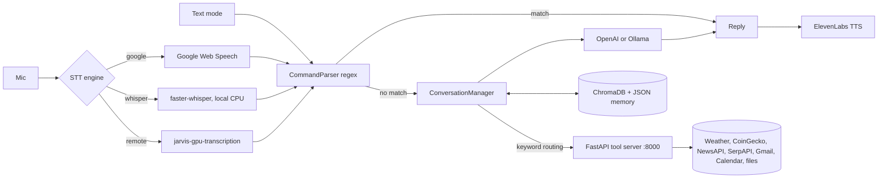

# Jarvis Voice Assistant

A personal voice assistant in Python: speech in, a regex command layer plus an LLM
with tool calls in the middle, ElevenLabs speech out. External tools (weather,
crypto, news, web search, Gmail, Google Calendar, files) sit behind a small
authenticated FastAPI server.

> **Demo video:** not recorded yet. A short walkthrough of voice mode is planned.

## What works today

| Area | Status |
|------|--------|
| Text mode (`python main.py text`) | Works with no microphone and no API keys. Built-in commands answer locally. |
| Voice mode (`python main.py voice`) | Continuous listen, transcribe, respond loop. No wake word in this mode (see Status). Needs a microphone and PyAudio. |
| Speech-to-text | Three engines: Google Web Speech (free, via SpeechRecognition), local faster-whisper (`medium`, CPU int8), or a remote GPU server ([jarvis-gpu-transcription](https://github.com/mikecavallo/jarvis-gpu-transcription)). |
| Built-in commands | Time, date, open browser, Google search, open website, help, status, goals, todos, quit. Regex-based, extensible at runtime. |
| Conversation | Anything that is not a built-in command goes to OpenAI (`gpt-4o-mini`) if `OPENAI_API_KEY` is set, otherwise a local Ollama (`llama2`) if one is running. |
| Tool calls | Keyword routing sends crypto, weather, news, search, file, calendar and email questions to the tool server and feeds the result to the LLM. Requires an LLM provider. |
| Tools | Weather (OpenWeatherMap), crypto (CoinGecko, no key), news (NewsAPI), web search (SerpAPI), filesystem (home directory only), whitelisted system commands (off by default), Gmail and Google Calendar (OAuth). |
| Voice output | ElevenLabs REST API, played with pygame. Without a key, replies are text only. |
| Memory | ChromaDB stores conversations for "what did we talk about" questions; learned personal facts in `memory/personal_memory.json`; goals, todos and an action log in `jarvis_state.json`. |
| Tests / CI | 70 offline pytest tests (parser, config, tool handlers, tool server auth and validation, routing, remote STT client) and ruff, run by GitHub Actions. |

## Architecture



More detail, including every tool endpoint and the runtime files Jarvis writes, is
in [docs/architecture.md](docs/architecture.md).

The tool server is called "MCP server" in the code, but it is a plain REST API,
not an implementation of the Model Context Protocol spec.

## Setup

Tested on Linux (Ubuntu) with Python 3.11. macOS should work for text mode; voice
mode there is untested.

```bash
git clone https://github.com/mikecavallo/jarvis-voice-assistant.git
cd jarvis-voice-assistant

python3.11 -m venv jarvis_env          # the scripts and Makefile expect this name
source jarvis_env/bin/activate
pip install -r requirements.txt

cp .env.example .env
# set MCP_API_KEY (python -c "import secrets; print(secrets.token_urlsafe(32))")
# and any API keys you have
```

For voice mode also install PortAudio and PyAudio:

```bash
sudo apt install portaudio19-dev python3-dev ffmpeg   # macOS: brew install portaudio ffmpeg
pip install PyAudio==0.2.14
```

`make install` / `make setup` do the venv, install and `.env` steps for you.

## Running

```bash
python main.py text        # keyboard in, text out (no mic or keys needed)
python main.py voice       # microphone in, speech out
python main.py test        # self-check: parser, TTS, mic, state
python main.py             # asks which mode
```

Tool calls need the tool server running in another terminal:

```bash
python start_mcp_server.py           # 127.0.0.1:8000
```

`./start_jarvis.sh [voice|text|test]` (or `make start-voice`) checks `.env`,
starts the tool server in the background and launches Jarvis with ALSA warning
noise filtered out.

### Using a GPU transcription server

Run [jarvis-gpu-transcription](https://github.com/mikecavallo/jarvis-gpu-transcription)
on a machine with an NVIDIA GPU, then point Jarvis at it:

```bash
SPEECH_RECOGNITION_ENGINE=remote
SPEECH_RECOGNITION_REMOTE_URL=http://192.168.1.50:8000
SPEECH_RECOGNITION_REMOTE_MODE=fast        # or accurate
TRANSCRIPTION_API_KEY=...                  # only if the server sets one
```

Jarvis posts each utterance to `POST /transcribe/{fast|accurate}` as multipart
form data (`audio_file` = 16 kHz WAV, `language` form field, e.g. `en`) with an
optional `X-API-Key` header, and reads `text` from the JSON response. If the server
is unreachable it falls back to Google for that utterance. Both servers default to
port 8000, so run them on different machines or start the transcription server
with `--port 8001`.

## Configuration

Secrets go in `.env` (see [.env.example](.env.example)); nothing secret belongs in
`config.json`.

| Variable | Used for | Required |
|----------|----------|----------|
| `MCP_API_KEY` | Bearer token between Jarvis and the tool server | Yes, for tools |
| `OPENAI_API_KEY` | Conversation and tool-call answers (else local Ollama) | No |
| `ELEVENLABS_API_KEY` | Spoken replies | No |
| `OPENWEATHER_API_KEY` | Weather tool | No |
| `SERPAPI_KEY` | Web search tool | No |
| `NEWS_API_KEY` | News tool | No |
| `SPEECH_RECOGNITION_ENGINE` | `google`, `whisper` or `remote` | No (default `whisper`) |
| `SPEECH_RECOGNITION_REMOTE_URL`, `TRANSCRIPTION_API_KEY` | Remote GPU transcription | Only for `remote` |
| `MCP_HOST`, `MCP_PORT`, `MCP_SERVER_URL`, `ALLOWED_ORIGINS`, `RATE_LIMIT_PER_MINUTE` | Tool server location and limits | No |
| `SYSTEM_COMMANDS_ENABLED` | Allow whitelisted system commands | No (default off) |

Non-secret settings (wake word, voice ID, timeouts) live in `config.json`, which
is created with defaults on first run. Any setting can be overridden with an
environment variable named `SECTION_KEY`, for example `ELEVENLABS_VOICE_ID` or
`SPEECH_RECOGNITION_LANGUAGE`.

Gmail and Google Calendar need an OAuth client from Google Cloud Console:
run `python setup_google_credentials.py` for the steps; tokens are stored in
`credentials/` (git-ignored). `python setup_api_keys.py` shows where to get each
API key and which ones are already set.

## Development

```bash
pip install -r requirements-dev.txt   # light: no audio, Whisper or ChromaDB
pytest                                # offline; no mic, network or keys
ruff check .
```

Hardware diagnostics live in `scripts/`: `mic_check.py` records a clip to a WAV
file and runs Google recognition on it, `transcription_benchmark.py` compares Google and Whisper on your mic.

```
main.py                  entry point (voice / text / test modes)
voice_input.py           mic handling and STT engines
remote_transcription.py  client for jarvis-gpu-transcription
command_parser.py        regex built-in commands
elevenlabs_output.py     TTS
config.py                config.json + env overrides
memory/                  state, ChromaDB, personal memory, LLM providers, tool client
mcp_server/              FastAPI tool server and tools
scripts/                 diagnostics and the quiet launcher
tests/                   pytest suite
docs/architecture.md     design, endpoints, roadmap
```

## Status and known gaps

- Voice mode runs a continuous conversation loop; the wake-word loop in
  `voice_input.py` exists but is not wired to any mode yet.
- Tools are only reached through the LLM fallback, so without OpenAI or Ollama
  questions like "what's the weather" get an "AI unavailable" reply.
- Gmail and Calendar integrations are implemented but not exercised by the
  automated tests. Their "analysis" and "smart reply" features are keyword and
  template based, and the insights actions return placeholder data.
- The news tool client can pass a search query, but the server endpoint only
  serves top headlines.
- Voice capture, Whisper and ElevenLabs playback are not covered by CI because
  they need audio hardware.
- Planned but not started: sub-agents, Slack/web/mobile interfaces, a real Model
  Context Protocol implementation. See the roadmap in
  [docs/architecture.md](docs/architecture.md#roadmap-from-the-original-prd-not-implemented).

Security notes are in [SECURITY.md](SECURITY.md).

## License

[MIT](LICENSE)
