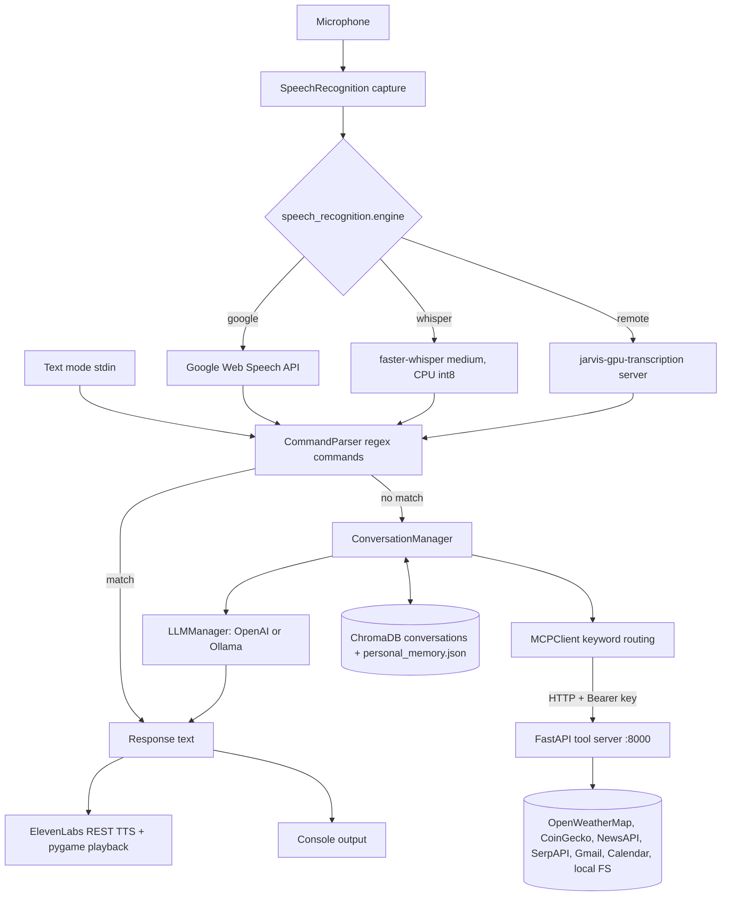

# Jarvis architecture

This document replaces the earlier `Jarvis_PRD.md`, `requirements.md` and
`REFACTOR_SUMMARY.md`. It describes how the code is put together today and keeps
the original product goals as a roadmap, clearly separated from what exists.

## Request flow



1. **Input.** Voice mode records with `SpeechRecognition` and transcribes with the
   configured engine. Text mode reads stdin and skips audio entirely.
2. **Built-in commands.** `command_parser.py` matches a fixed list of regex
   patterns (time, date, open browser, Google search, open website, help,
   status, goals, todos, quit) and answers locally.
3. **Conversation fallback.** Anything else goes to
   `memory/conversation_manager.py`, which:
   - checks `MCPClient.can_handle_request()` for tool keywords (crypto, weather,
     news, search, files, calendar, email) and, if one matches, calls the tool
     server first;
   - builds a system prompt with personal facts, tool results and (for "what did
     we talk about" style questions) matching past conversations from ChromaDB;
   - asks the LLM (OpenAI `gpt-4o-mini` if `OPENAI_API_KEY` is set, else a local
     Ollama `llama2` on `localhost:11434` if one is running).
   Without any LLM provider the fallback returns a "conversational AI unavailable"
   message, so tool calls are only reachable when an LLM is configured.
4. **Output.** The reply is printed and, with `ELEVENLABS_API_KEY` set, spoken via
   the ElevenLabs REST API and played with pygame.

## Components

| Path | Role |
|------|------|
| `main.py` | Entry point; `voice`, `text` and `test` modes. |
| `voice_input.py` | Microphone selection and calibration, VAD-style listening, STT engines. |
| `remote_transcription.py` | Client for the companion GPU transcription server. |
| `command_parser.py` | Regex command registry; extensible with `add_custom_command`. |
| `elevenlabs_output.py` | ElevenLabs TTS over HTTP, pygame playback. |
| `config.py` | `config.json` defaults plus `SECTION_KEY` environment overrides. |
| `memory/state_manager.py` | `jarvis_state.json`: goals, todos, action log. |
| `memory/chroma_manager.py` | ChromaDB collections for conversations, facts, email/calendar data. |
| `memory/personal_memory.py` | `memory/personal_memory.json`: name, location, preferences. |
| `memory/llm_interface.py` | OpenAI and Ollama providers behind one interface. |
| `memory/mcp_client.py` | Keyword router and HTTP client for the tool server. |
| `mcp_server/server.py` | FastAPI app: Bearer auth, per-IP rate limit, input validation, security headers. |
| `mcp_server/tools/*.py` | One class per tool, all subclasses of `BaseTool`. |
| `scripts/` | Hardware diagnostics (`mic_check.py`, `transcription_benchmark.py`) and `run_quiet.py` (filters ALSA noise). |
| `agents/` | Empty placeholder for the planned sub-agents. |

### About the name "MCP server"

The tool server is a plain REST API built with FastAPI. It borrows the
Model Context Protocol name but does not implement the MCP JSON-RPC spec, so it
cannot be plugged into MCP clients such as Claude Desktop as-is.

### Tool server endpoints

| Endpoint | Tool | Needs |
|----------|------|-------|
| `GET /health` | all | nothing (public) |
| `POST /mcp` | any tool by name, `{tool, action, parameters}` | `MCP_API_KEY` |
| `GET /weather?location=&forecast=` | OpenWeatherMap current/forecast | `OPENWEATHER_API_KEY` |
| `GET /crypto?symbol=&vs_currency=` | CoinGecko price | none |
| `GET /news?category=&country=` | NewsAPI top headlines | `NEWS_API_KEY` |
| `GET /search?q=` | SerpAPI Google results | `SERPAPI_KEY` |
| `POST /gmail?action=` | Gmail list/read/send/draft/search, keyword-based analysis | Google OAuth files |
| `POST /google_calendar?action=` | Calendar list/create/update/delete, conflicts, free time | Google OAuth files |
| `POST /fs/{path}` | read/write/list inside the user's home directory | none |
| `POST /system/{command}` | whitelisted commands only (an `echo` test by default) | `SYSTEM_COMMANDS_ENABLED=true` |

`email` and `calendar` are older stub tools that return "not yet implemented";
the working integrations are `gmail` and `google_calendar`.

## Pairing with jarvis-gpu-transcription

[jarvis-gpu-transcription](https://github.com/mikecavallo/jarvis-gpu-transcription)
is a FastAPI faster-whisper server meant for a machine with an NVIDIA GPU. Jarvis
talks to it when `SPEECH_RECOGNITION_ENGINE=remote`:

```
POST {SPEECH_RECOGNITION_REMOTE_URL}/transcribe/fast      (or /transcribe/accurate)
Content-Type: multipart/form-data
  audio_file = <16 kHz 16-bit WAV>
  language   = en            (form field; locale "en-US" is reduced to "en")
X-API-Key: {TRANSCRIPTION_API_KEY}   (only sent when set)

200 -> {"text": "...", ...}
```

If the server is down or rejects the key, Jarvis logs the error and falls back to
Google speech recognition for that utterance. Both servers default to port 8000,
so run the transcription server on the GPU machine or move one of them
(`MCP_PORT`, or the transcription server's `--port`).

## Data written at runtime (all git-ignored)

| File | Contents |
|------|----------|
| `config.json` | Non-secret settings (created on first run, mode 600). |
| `jarvis_state.json` | Goals, todos, action log. |
| `memory/personal_memory.json` | Facts the assistant learned about the user. |
| `memory/chroma_db/` | Conversation and email/calendar embeddings. |
| `credentials/` | Google OAuth client secrets and tokens. |

## Roadmap (from the original PRD, not implemented)

These were goals in the August 2025 product document. None of them exist in the
code yet:

- Specialised sub-agents (a coding assistant and a crypto analyst) sharing the
  tool server.
- Slack bot, web dashboard, desktop GUI and a mobile companion.
- Wake-word activation as a background service. A `listen_for_wake_word` loop
  exists in `voice_input.py`, but voice mode currently runs a continuous
  conversation loop without a wake word.
- Screenshot context and screen control.
- Structured JSON logging per component and a coverage target for tests.
- Implementing the real Model Context Protocol so other MCP clients can use the
  tools.
